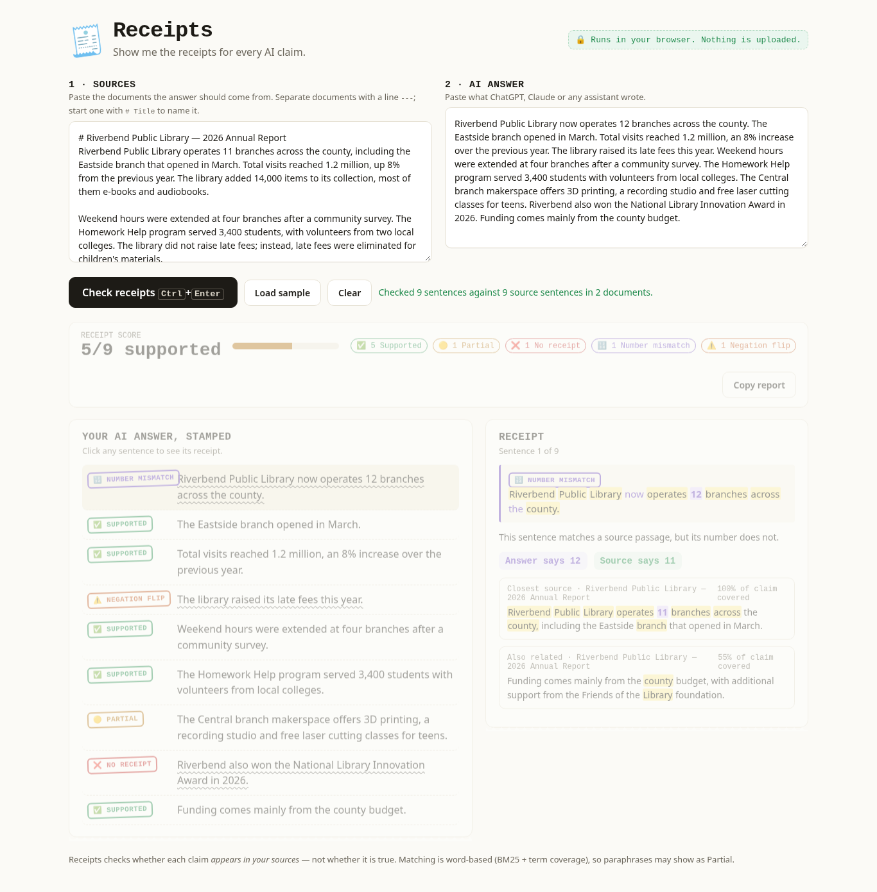

# 🧾 Receipts

**Before you pay, find what doesn't add up in this bill.**

Check a bill against the quote you agreed to, or an AI answer against its sources, line by line. Try it: https://igoreduardoai.github.io/receipts/



Paste the text to check (bill lines or an AI answer) and the sources it should match. Receipts checks it **line by line** and stamps each one:

| Stamp | Meaning |
|---|---|
| ✅ Supported | The claim's meaningful words appear together in one source passage. |
| 🟡 Partial | Part of the claim has a receipt; the rest doesn't. |
| ❌ No receipt | Nothing in the sources covers it — possibly invented. |
| 🔢 Number mismatch | Worded like the source, but a number changed (says 12, source says 11). |
| ⚠️ Negation flip | Worded like the source, but one says "not/no/never" and the other doesn't. |

Click any sentence to see its receipt: the closest source sentence, the document it came from, the shared words highlighted, and — for mismatches — the two numbers side by side. **Copy report** exports a Markdown checklist.

Everything runs locally in the browser. No model, no API key, no server, no upload.

> Receipts checks whether a claim **appears in your sources**, not whether it is true.

## Run it

Requirements: any modern browser. For the local server, Python 3 (or any static server). Node 20+ for tests.

```bash
npm start          # serves the folder at http://localhost:5173 (python3 -m http.server)
# open http://localhost:5173 → "Load a sample…" → "Check receipts"
npm test           # 13 engine tests (node:test, zero dependencies)
```

Opening `index.html` straight from disk can be blocked by some browsers because it uses ES modules; use `npm start` or any static host (GitHub Pages works as-is).

### Using your own text
- Paste one or more documents into **Sources**. Put a line with `---` between documents and start a document with `# Title` to name it.
- Paste the bill lines or the AI answer (paragraphs or bullets) into **Text to check**.
- Press **Check receipts** or Ctrl/⌘+Enter. Arrow keys move between sentences.

## How it works
`src/engine.js` (pure functions, fully tested):
1. Splits sources into documents and sentences (abbreviation- and decimal-safe), and indexes each sentence plus each adjacent pair as a passage.
2. Turns every sentence into content terms: lowercase, stopwords removed, light stemming, a tiny synonym map (rose/grew/up → increase).
3. For each answer sentence, scores every passage by **IDF-weighted term coverage** (how much of the claim's rare, meaningful vocabulary the passage contains), with BM25 as the tiebreaker.
4. Coverage ≥ 60% → Supported, ≥ 35% → Partial, else No receipt.
5. On any matched claim, two detectors run: numbers in the claim that are absent from the matched passages → **Number mismatch**; negation on only one side → **Negation flip**.

Why no LLM? A judge model costs money, needs a key, can hallucinate itself, and its verdict can't be audited. Every Receipts verdict is explained by the highlighted words.

### Known limits
- Word-based: a paraphrase with totally different words shows as Partial / No receipt (the closest passage is still shown).
- English stopwords and stemming only.
- Compares line by line; it does not recompute totals.
- Checks presence in sources, not truth, and is not a substitute for professional review.

## Project layout
```
index.html            page
src/engine.js         matching engine (pure, tested)
src/app.js            UI wiring, evidence panel, report, local save
src/sample.js         fictional samples (a plumber's quote with two bills; a library report)
src/styles.css        receipt-paper look
tests/engine.test.js  node:test suite
devpost/              scope.md, prd.md, spec.md, checklist.md, app-map.html (Devpost Learn skill pack)
```

## Built for Build With AI: Basics
Built from an empty folder during the hackathon with the [Devpost Learn skill pack](https://github.com/challengepost/learn-ai-basics) (`.agents/skills/`), following start → scope → PRD → spec → build. The planning documents are in [`devpost/`](devpost/). No pre-existing code is used; the only third-party material is the skill pack itself. The sample data is entirely fictional.

## License
[MIT](LICENSE) © 2026 Igor Eduardo
